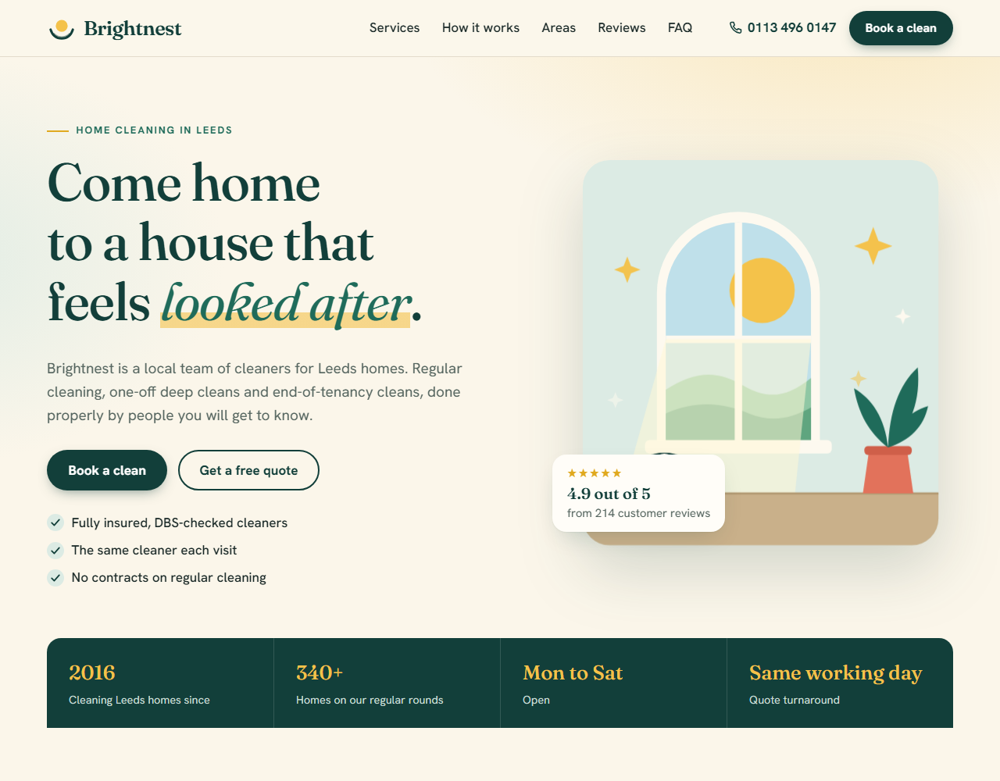
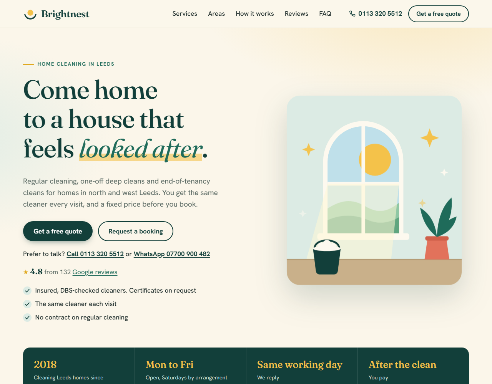
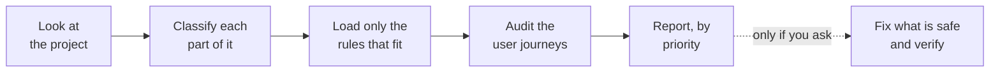

<h1 align="center">adaptive-fwm-ux-ui</h1>

<p align="center">
  <strong>Your AI coding agent, trained to audit and fix UX and UI<br>without breaking how your product works or what it looks like.</strong>
</p>

<p align="center">
  
  
  
  
  
</p>

<p align="center">
  <a href="#quick-start">Quick start</a> ·
  <a href="docs/examples/README.md">Examples</a> ·
  <a href="docs/usage.md">What you can ask</a> ·
  <a href="docs/selling.md">Selling</a> ·
  <a href="docs/how-it-works.md">How it works</a> ·
  <a href="docs/faq.md">FAQ</a>
</p>

<br>

<p align="center">
  
  
</p>

<p align="center">
  <em>Before and after. Asked only to "make this page convert", the skill found a form that sent nothing,<br>a placeholder phone number and invented reviews, then rebuilt the page from the owner's real answers.</em>
</p>

---

## Why it's different

Most UX checklists apply the same rules to everything. A fashion store and a server dashboard have almost nothing in common, so this skill **looks first, then judges**.

| | |
|---|---|
| 🎯 **Advice that fits** | It works out what each part of your product is for, then loads only the rules that match. |
| 📚 **Reasons, not opinions** | Every finding names what it rests on: an accessibility requirement, published research, or a judgment call. |
| 🔒 **Nothing broken** | Read-only by default. Fixes touch presentation only, never pricing, checkout, logins or data. |
| 🎨 **Your brand, kept** | It works inside your colors, type and style. It has no house style. |
| ✅ **Nothing invented** | No fake reviews, countdowns, prices or statistics. If proof is missing, it tells you what to supply. |

## Quick start

**1. Install**

```bash
git clone https://github.com/HamoodMMD/adaptive-fwm-ux-ui.git ~/.claude/skills/adaptive-fwm-ux-ui
```

Codex, Windows and per-project installs: [installation guide](docs/install.md).

**2. Ask in plain words**

> Audit my website's UX. Don't change anything.

**3. When you're ready**

> Fix the safe issues.

There are no commands to learn. *Audit, review, check* never change a file. *Fix, improve, apply* do.

## What you can ask

| You want to… | Say something like… |
|---|---|
| Find problems | "Audit my site" · "What's wrong with this page?" |
| Find and fix | "Fix the UX issues" · "Apply the safe changes" |
| Focus on one thing | "Accessibility pass" · "Check it on mobile" · "Are my font sizes right?" |
| Make a page sell | "Make this page convert" · "Why does nobody sign up?" |
| Check a claim | "This video says to use loss aversion on my upgrade screen. Is that right?" |
| Plan before building | "Plan the UX for a booking flow" |

[See everything you can ask →](docs/usage.md)

## Your site is a salesperson

A confusing site loses visitors the way a bad salesperson loses customers. For any page that sells, the skill walks through it as a first-time visitor on a phone and writes down every moment a reasonable person would leave, and why.

It then names the selling strategy your site is attempting (thirteen are defined, from Apple-style storytelling to plain dealing), checks whether your interface carries it out, and can rebuild the page step by step. It never invents an offer and never promises a sales increase.

[How it judges and rebuilds selling pages →](docs/selling.md)

## How it works



43 rule modules cover stores, service sites, SaaS apps, dashboards, admin tools, AI products, bookings and more, plus forms, tables, navigation, type and sizes, mobile, and Arabic and other right-to-left layouts.

[The full workflow, every module, and what it will never do →](docs/how-it-works.md)

## More examples

Six demo pages, each audited and fixed by AI agents using only this skill, with no hints about what was wrong. Logic files untouched and tests passing in every one.

| | |
|---|---|
| **Status page** that said "All systems operational" during an outage | **Clinic booking** with a fake "Only 1 slot left" badge |
| **Staff orders table** that was hard to scan | **Arabic checkout** with a reversed phone number |

[See the screenshots and write-ups →](docs/examples/README.md)

## Learn more

| | |
|---|---|
| [What you can ask](docs/usage.md) | Every kind of request, and which ones edit files |
| [Selling pages](docs/selling.md) | The six sales stages, thirteen strategies, and honest persuasion |
| [How it works](docs/how-it-works.md) | Workflow, modules, safety limits, file layout |
| [Installation](docs/install.md) | Claude Code, Codex, Windows, updating |
| [Questions and limitations](docs/faq.md) | What it can't do, and how it was tested |
| [Changelog](CHANGELOG.md) | What changed in each version |

## License

No license has been chosen yet. Until one is added, default copyright applies and others may not reuse this work.
