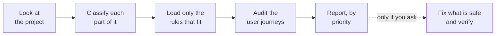

# How it works



1. **Look.** It reads what you said, your docs, your code, your pages and your copy before asking you anything.
2. **Classify.** It splits the product into *surfaces* (groups of screens with the same users and goal) and describes each one: who uses it, why, on what device, how risky a mistake is, what language.
3. **Load.** It picks one main profile, up to two supporting ones, and the patterns for what is actually on screen.
4. **Audit.** It walks through what users are trying to do, then checks individual screens.
5. **Report.** Findings are ranked from **P0** (blocks people) to **P3** (polish), each with its evidence. It also lists what already works, so good parts are not redesigned.
6. **Fix, if asked.** Small groups of changes, tests run before and after, the full diff checked, and anything it could not verify is said plainly.

**Examples of what gets loaded:**

| Your product | Rules it uses |
|---|---|
| Fashion store | ecommerce + fashion + filters, forms, mobile |
| Agency or service website | service business + lead generation + forms, pricing, visual scale |
| Monitoring tool | SaaS app + monitoring + dashboards, charts, tables |
| AI workspace | SaaS app + AI product + forms, loading and error states |
| Staff admin panel | admin tools + tables, filters, forms |
| Booking marketplace | booking + marketplace + filters, forms |

<details>
<summary><strong>All 43 rule modules</strong></summary>

<br>

**Core (5)** — apply everywhere
`universal-ux` · `accessibility` · `performance` · `content-and-trust` · `brand-preservation`

**Profiles (14)** — chosen by what the surface is for
`ecommerce` · `fashion-apparel` · `sales-lead-generation` · `service-business` · `informational-content` · `b2b-marketing` · `saas-application` · `dashboard-analytics` · `monitoring-observability` · `admin-backoffice` · `ai-product` · `booking-reservation` · `marketplace-directory` · `high-stakes`

**Patterns (24)** — chosen by what is on the screen
`forms` · `navigation` · `tables` · `search-filter-sort` · `charts-data-viz` · `loading-empty-error-states` · `responsive-mobile` · `rtl-bilingual` · `visual-scale` · `pricing-and-persuasion` · `sales-journey` · `ux-psychology` · `virtual-goods` · `product-page` · `onboarding` · `conversion-and-retention` · `account-security` · `notifications` · `component-libraries` · `dark-mode-and-themes` · `motion` · `visual-styles` · `roles-and-permissions` · `localization`

Plus a catalog of thirteen selling strategies in `references/selling-strategies.md`.

Every module has the same shape: when to load it, objectives, principles, concrete checks, anti-patterns, exceptions, cautions for implementation, and sources.

</details>

## Sizes and type

**`visual-scale`** covers font sizes, line length, header height, the first screen and button sizes. It keeps three kinds of number apart so you know how much weight each carries:

| Kind | Example |
|---|---|
| **Requirement** (can be failed) | Tap targets at least 24 by 24 pixels; text resizable to 200% |
| **Published guidance** | Body text at least 16px; 50 to 75 characters per line |
| **Observed practice** (measured on 28 well-known commercial sites) | Main headline around 64px on desktop and 38px on phones; header about 72px and 64px |

It will not resize your type just to match what is typical.

It also covers typeface and case, text over images, light and dark surfaces, fluid type that still zooms, and spacing.

## What it will never do

These hold in every mode, whatever you ask for in passing.

**It will not change how your product works.** Unless you explicitly ask for functional work, it leaves alone: APIs, databases, routes, logins and permissions, pricing, tax, stock, cart and checkout, payments, bookings, alerts, analytics, AI prompts and integrations. If a real improvement needs one of those, it writes it up under *Functional recommendations — not implemented* and lets you decide.

**It will not redesign your brand.** Your logo, colors, fonts, spacing and style are treated as the brief. If your brand purple is too pale to read as small text, it stops using it for small text. It does not swap your purple.

**It will not invent anything to make a page look or sell better.** No price, plan, discount, "free" offer, deadline, stock count, testimonial, rating or statistic appears unless your project already states it. If your page would be stronger with a real testimonial or a starting price, it tells you what to supply and leaves the space empty.

**It will not use tricks.** No fake urgency, fake scarcity, hidden fees, pre-ticked boxes, or guilt-trip wording, even if it would lift a number.

**It will not commit or push** unless you tell it to.

## Under the hood

```text
adaptive-fwm-ux-ui/
├── SKILL.md                      the router: workflow, loading tables, rules that always hold
├── references/
│   ├── classification.md         how surfaces are classified
│   ├── conflict-resolution.md    what wins when rules disagree
│   ├── implementation-safety.md  what may be edited, and the procedure
│   ├── conversion-pass.md        step-by-step: an ordinary page into one that sells
│   ├── measuring-results.md      how to tell honestly whether a change worked
│   ├── selling-strategies.md     thirteen ways a site can sell, when each fits, how each fails
│   ├── research-sources.md       all 335 sources, with how each was checked
│   ├── core/                     5 modules for every surface
│   ├── profiles/                 14 modules chosen by classification
│   └── patterns/                 18 modules chosen by what is on screen
├── assets/                       report templates
└── docs/examples/                before and after screenshots with write-ups
```

Sources include WCAG 2.2, Nielsen Norman Group, Baymard Institute, GOV.UK and US government design systems, Google and Apple platform guidance, peer-reviewed studies on decision-making, and consumer-protection rules. Each entry records whether the page was read in full or confirmed by summary only.

See the [changelog](../CHANGELOG.md) for what changed in each version.

---

[← Back to the main page](../README.md)
